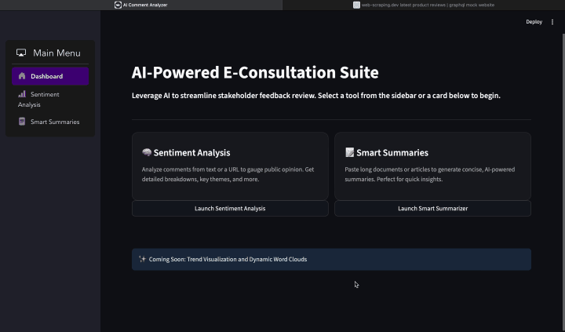
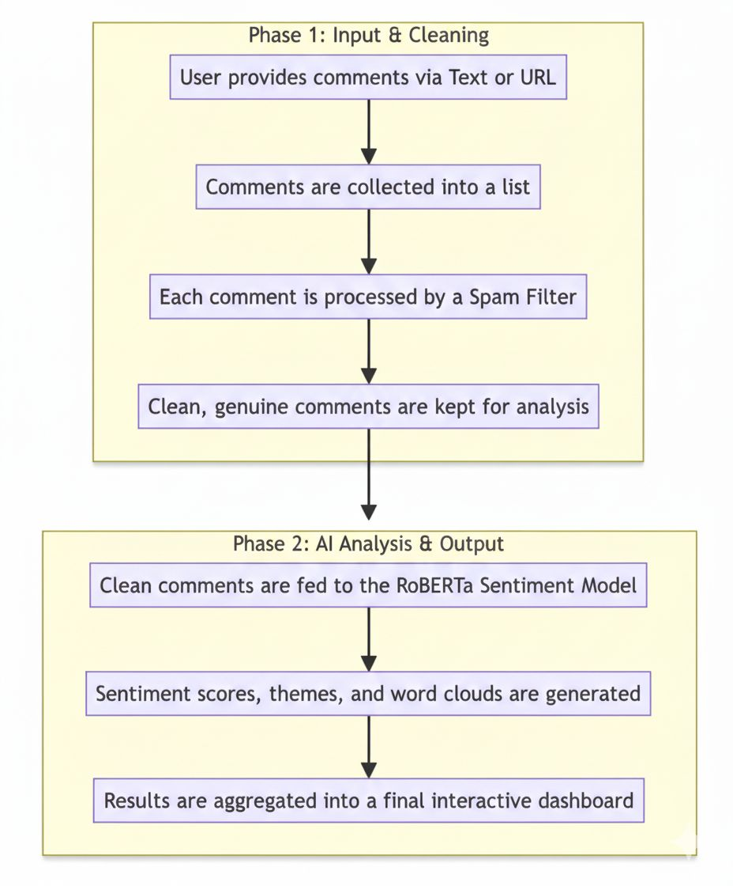

# AI-Powered E-Consultation Suite

A Streamlit web app that analyzes, summarizes and extracts themes from large volumes of public feedback for government e-consultations. Built as a solution for the Smart India Hackathon (SIH).



## The problem
Ministries and organizations receive thousands of public comments during an e-consultation. Reading and analyzing them by hand is slow, expensive and easy to bias. This app automates the first pass so reviewers can see public opinion and the main concerns quickly.

## Features
- **Sentiment analysis:** a RoBERTa transformer (`cardiffnlp/twitter-roberta-base-sentiment-latest`) scores each comment as Negative, Neutral or Positive. The app shows the overall sentiment, its confidence and a per-class breakdown chart.
- **Summarization:** `sshleifer/distilbart-cnn-12-6` condenses long text. Text longer than the model's input limit is split into chunks, summarized piece by piece, then summarized once more.
- **Web scraping:** paste a URL and the app collects paragraph text with Playwright. Only public `http(s)` sites on ports 80, 443, 8080 and 8443 are allowed. The address is resolved once and checked, and the browser is pinned to that exact IP, so a later DNS answer cannot redirect it (DNS rebinding). Every request the browser makes, including redirects and scripts, may only go to that one host.
- **Spam filtering:** an optional rule-based step removes duplicate comments, link or promotion spam, repeated-character junk and mostly-symbol text before analysis.
- **Key themes and word cloud:** the most frequent words and two-word phrases, plus a word cloud.
- **Dashboard:** a sidebar menu and cards for each tool, with Plotly charts.

## Architecture


## Setup
```
git clone https://github.com/ArtNayak/Sentiment-Analysis-System.git
cd Sentiment-Analysis-System
python -m venv venv
venv\Scripts\activate            # macOS/Linux: source venv/bin/activate
pip install -r requirements.txt
playwright install chromium      # needed for the URL scraper
streamlit run app.py
```
The two Hugging Face models are downloaded the first time each page is opened, so the first run needs internet access and takes a while.

## Tests
```
python test_utils.py    # spam filter, URL safety, theme extraction
python test_app.py      # runs every page of app.py with stand-in models (no downloads)
```

## Notes and limits
- The scraper reads generic `<p>` paragraphs, so results depend on the site's markup. Some sites will return little or nothing.
- The spam filter is a set of simple rules, not a trained model. Review the "removed" count if results look off.
- At most 500 comments are analyzed per run.
- Summary length sliders are in model tokens (roughly 1.3 tokens per word).
- Because the scraper only talks to the page's own host, pages that need other hosts to render (for example a separate API or CDN domain) may come back empty. URLs with user-info, backslashes or whitespace are refused. For a public deployment, also run the app with no network route to internal ranges.

## Acknowledgements
Built on Streamlit, Hugging Face Transformers and PyTorch.
* **Sentiment model:** `cardiffnlp/twitter-roberta-base-sentiment-latest`
* **Summarization model:** `sshleifer/distilbart-cnn-12-6`
